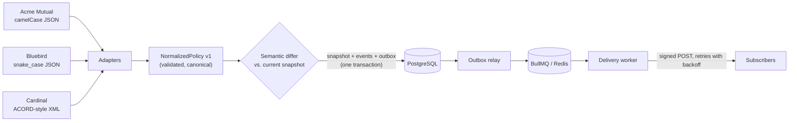

# PolicyWatch

**Event-driven insurance policy monitoring with reliable, signed webhook delivery.**

PolicyWatch polls insurance carrier APIs, normalizes three very different payload formats into one
contract, detects meaningful policy changes (cancellations, renewals, coverage and premium changes,
vehicles added or removed), and delivers HMAC-signed webhooks with retries, an audit trail and
at-least-once semantics.

The carriers are simulated and every record is synthetic. The point is the engineering around them:
heterogeneous third-party integration, deterministic change detection, transactional outbox,
idempotent processing, SSRF-safe webhook delivery, observability, and reproducible infrastructure.

**TypeScript · Node.js 22 · Express 5 · PostgreSQL 17 · Prisma · Redis · BullMQ · Zod · Pino ·
Docker Compose · Terraform · Ansible · AWS (EC2, IAM, CloudWatch, SSM, DLM) · GitHub Actions · Vitest**

---

## What it does



1. A scheduler (or `POST /policies/:id/check`) queues a check.
2. The worker fetches the policy from the carrier, classifies every failure, and normalizes the response.
3. Under a row lock it compares the result with the stored version. Identical content (even if
   formatted differently) is `UNCHANGED`; otherwise a new snapshot, its events and outbox rows commit
   **in one transaction**.
4. The outbox relay fans each event out to matching subscriptions; delivery workers POST signed
   payloads, retry transient failures with exponential backoff and jitter, and record every attempt.

An unreachable carrier, a 503, a malformed body or a "still processing" response is recorded as a
failed check with a category — **it never becomes a cancellation**.

## Quick start (Docker)

```bash
cp .env.example .env
docker compose up -d --build        # postgres, redis, migrations, api, worker, carrier simulator, mock receiver
docker compose run --rm seed        # enroll the six synthetic policies (optional)
docker compose run --rm demo        # the guided demo (see below)
```

- API: <http://localhost:3000> · Swagger UI: <http://localhost:3000/docs> · health: `/health`
- Every published port is bound to `127.0.0.1`.

```bash
source .env
curl -s localhost:3000/policies -H "Authorization: Bearer $ADMIN_API_KEY" | jq '.data[] | {id, carrierId, status}'
```

### Without Docker

Requires Node.js 22+, PostgreSQL 14+ and Redis 6.2+ (set `DATABASE_URL` / `REDIS_URL` in `.env`).

```bash
npm ci
npx prisma migrate deploy
npm run dev            # api :3000, worker :3001, carrier simulator :4000, mock receiver :4100
npm run db:seed
npm run demo
```

## The demo (≈ 3 minutes)

`npm run demo` / `docker compose run --rm demo` walks through:

1. Create an active synthetic auto policy at a simulated carrier and enroll it (baseline, no events).
2. Register a webhook subscription.
3. The carrier cancels the policy, and the subscriber's endpoint goes down (503).
4. Trigger a policy refresh.
5. `POLICY_CANCELLED` is generated.
6. The first webhook delivery fails.
7. Automatic retries with exponential backoff.
8. The receiver recovers.
9. Delivery succeeds; the receiver verified every signature.
10. Policy history (v1 ACTIVE → v2 CANCELLED) and the delivery audit trail.

Bonus: a manual redelivery is flagged as a duplicate by the receiver (de-duplication on `eventId`).
Use `DEMO_STEP_PAUSE_MS=12000` to pace it for a live audience. Details: [docs/demo.md](docs/demo.md).

## API

All endpoints except health and docs require `Authorization: Bearer <key>` (admin key, or an optional
read-only key for `GET`s). Full spec: [`openapi/openapi.yaml`](openapi/openapi.yaml), served at `/docs`.

| Method | Path | |
|---|---|---|
| GET | `/health`, `/health/live` | Readiness (DB, Redis, live workers) / liveness |
| GET | `/policies` | List (filters: `carrierId`, `status`; keyset pagination) |
| POST | `/policies` | Enroll a carrier policy |
| GET / PATCH | `/policies/:id` | Policy + current NormalizedPolicy / monitoring settings |
| GET | `/policies/:id/history` | Versions with the events each produced |
| GET | `/policies/:id/checks` | Monitoring audit (incl. failures and categories) |
| POST | `/policies/:id/check` | Immediate check (`?wait=true` returns the result) |
| GET | `/events`, `/events/:id` | Domain events (filters: policy, carrier, type, since) |
| POST / GET | `/subscriptions` | Create (secret returned once) / list |
| GET / PATCH / DELETE | `/subscriptions/:id` | Inspect / activate · deactivate · edit / soft-delete |
| GET | `/deliveries`, `/deliveries/:id` | Delivery status and per-attempt audit trail |
| POST | `/deliveries/:id/retry` | Manual redelivery |
| GET | `/metrics` | Prometheus metrics |

Errors share one envelope: `{"error": {"code", "message", "details?", "requestId"}}`.

## Testing

```bash
npm test                    # unit + integration (needs PostgreSQL and Redis)
npm run test:unit           # no external dependencies
npm run test:coverage
npm run check               # typecheck + lint + tests
```

Integration tests run against **real PostgreSQL and Redis** (`TEST_DATABASE_URL`,
`TEST_REDIS_URL`; defaults to localhost, database `policywatch_test`, Redis DB 15), with the
carrier simulator and webhook targets started in-process on ephemeral ports.

| Area | Examples of what is proven |
|---|---|
| Change detection | every event type; renewal vs. reinstatement; coverage changes folded into vehicle events; deterministic ordering |
| Normalization | each carrier's two deliberately different renderings produce the identical content hash; leading-zero ZIPs survive XML; DTD/XXE rejected |
| Unavailable carriers | 12 fault scenarios across 3 carriers → `FAILED` with the right category, state untouched; backoff; recovery |
| Idempotency | re-checks emit nothing; 6 concurrent checks commit exactly one change; stale responses discarded |
| Outbox | atomic rollback of snapshot + events + outbox on failure; idempotent and concurrent relays |
| Webhooks | signature verifiable by a consumer; 503 → retry → success; bounded attempts; timeouts; permanent 4xx; 8 concurrent jobs → 1 HTTP request |
| Recovery | lost queue jobs, crashed workers holding locks, enqueue failures after commit; graceful shutdown drains in-flight work |
| Security | SSRF (private, metadata, IPv6-mapped, decimal/hex IPs, DNS rebinding at connect time); auth 401/403; secret shown once and encrypted at rest |
| API | validation, error envelope, pagination, every OpenAPI operation routed |

## Repository layout

```
src/
  api/            Express app, middleware (auth, correlation IDs, errors), routes, serializers
  carriers/       adapter interface, HTTP transport + failure classification, three adapters, registry
  domain/         NormalizedPolicy v1 schema, normalization rules, semantic differ, event types
  monitoring/     check-policy (the transactional core), scheduler, enrollment, timing
  outbox/         transactional outbox relay
  webhooks/       signing, SSRF guard, HTTP sender, retry policy, delivery service, sweeper
  worker/         BullMQ consumers + background loops, heartbeat, health server
  simulators/     carrier simulator (3 formats, faults, noise) and reference webhook receiver
  entrypoints/    api, worker, carrier-sim, mock-receiver processes
prisma/           schema and migrations
openapi/          OpenAPI 3.1 document
tests/            unit/ (pure) and integration/ (PostgreSQL + Redis)
scripts/          seed, demo, dev launcher
deploy/           production Compose file and Caddyfile (used on EC2)
infra/terraform/  VPC, security group, IAM, EC2, CloudWatch, alarms, snapshots + offline plan tests
infra/ansible/    roles: common, docker, cloudwatch_agent, policywatch
.github/workflows CI: tests, image build, compose validation, terraform, ansible-lint
```

## Documentation

| Doc | Contents |
|---|---|
| [Architecture](docs/architecture.md) | Component diagram, event delivery sequence, delivery state machine, reliability model |
| [NormalizedPolicy v1](docs/normalized-policy-v1.md) | The contract, normalization rules, carrier mapping |
| [Webhooks](docs/webhooks.md) | Payload schema per event type, signature verification, replay protection, de-duplication, retries, SSRF |
| [Database](docs/database.md) | ER diagram, table purposes, constraints, transaction boundaries |
| [Operations](docs/operations.md) | Logging, correlation, metrics, health, failure categories, configuration, runbook |
| [Design decisions](docs/design-decisions.md) | Trade-offs and the alternatives considered |
| [AWS deployment](docs/deployment-aws.md) | Cost estimate, Terraform plan/apply/destroy, secrets, Ansible, verification status |
| [Demo](docs/demo.md) | Step-by-step walkthrough and things to try |

## AWS (optional)

Terraform provisions a small, locked-down environment (one EC2 `t4g.small`, VPC, security group,
least-privilege IAM role, CloudWatch logs/metric filters/alarms, daily EBS snapshots); Ansible
hardens the host and deploys the Compose stack with secrets pulled from SSM Parameter Store on the
instance. Estimated **≈ $20–23/month** while running. Nothing is created unless you run
`terraform apply`. See [docs/deployment-aws.md](docs/deployment-aws.md) — including what was and was
not verified against real AWS.

## Known limitations

- Single-host deployment: no multi-AZ, PostgreSQL protected by daily snapshots only.
- Webhook secret rotation is not yet an API operation (receivers already accept multiple secrets).
- `POLICY_RENEWED` requires the carrier to report the new term as `ACTIVE`; a renewal reported first
  as `PENDING` and later `ACTIVE` is recorded as versions but not as a renewal event.
- No rate limiting on the API; no automatic pruning of audit tables.
- The OpenAPI document is hand-written; a test enforces that every documented route exists, not
  that response schemas match exactly.

## License

MIT. All carrier names, people, addresses, phone numbers and VINs are fictional.
