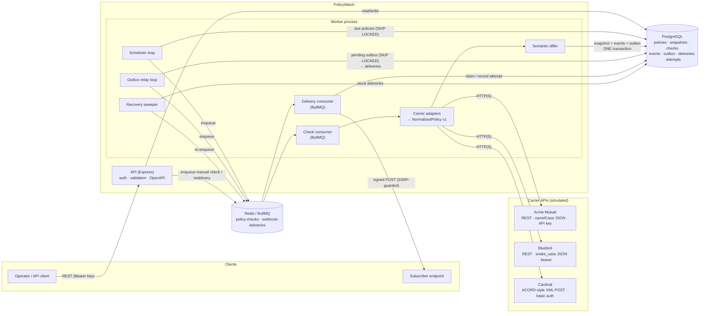
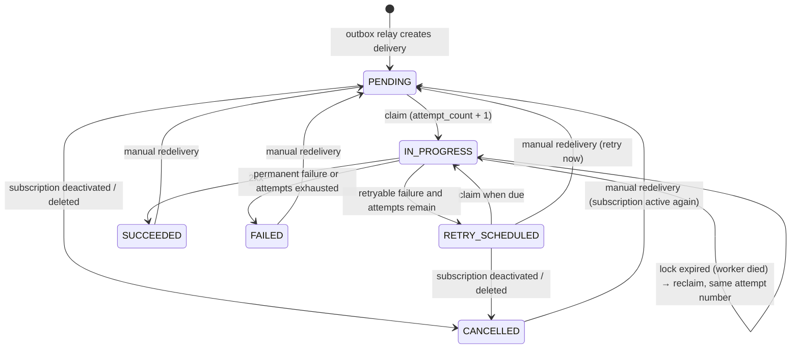

# Architecture

PolicyWatch is two Node.js processes (API and worker) around PostgreSQL and Redis, plus two
development doubles (a carrier simulator and a reference webhook receiver). PostgreSQL is the
system of record for everything; Redis/BullMQ only *triggers* work and can be lost without losing data.

## Components



| Component | Responsibility | Scales by |
|---|---|---|
| **API** (`src/api`) | Bearer-key auth, Zod validation, keyset pagination, OpenAPI at `/docs`, `/health`, `/metrics`. Never calls carriers or subscribers itself. | Stateless replicas |
| **Scheduler** (`src/monitoring/scheduler.ts`) | Every tick, leases due policies (`FOR UPDATE SKIP LOCKED`, push `next_check_at` out) and enqueues one deduplicated job per policy. | Any number of workers |
| **Check consumer** (`src/monitoring/check-policy.ts`) | Fetch → normalize → lock policy row → compare → write snapshot, events, outbox rows and the check record in one transaction. | BullMQ concurrency × workers |
| **Carrier adapters** (`src/carriers/adapters`) | Transport + auth per carrier, classification of every failure, pure parse functions into NormalizedPolicy v1. | Add a module + one registry line |
| **Differ** (`src/domain/diff.ts`) | Pure, deterministic semantic comparison of two snapshots → domain events. | — |
| **Outbox relay** (`src/outbox/relay.ts`) | Drains the outbox: one delivery row per matching subscription, idempotent fan-out, then enqueue. | Any number of workers |
| **Delivery consumer** (`src/webhooks/delivery-service.ts`) | Atomic claim, HMAC signing, SSRF-guarded POST, attempt audit, retry scheduling. | BullMQ concurrency × workers |
| **Sweeper** (`src/webhooks/sweeper.ts`) | Re-enqueues deliveries whose job was lost (Redis loss, crash between commit and enqueue, dead worker). | Idempotent |
| **Carrier simulator** (`src/simulators/carrier-sim`) | Three synthetic carriers with distinct wire formats, fault injection, formatting noise. Dev/test/demo only. | — |
| **Mock receiver** (`src/simulators/mock-receiver`) | Reference consumer: raw-body signature verification, replay window, `eventId` de-duplication, failure modes. | — |

## Event delivery sequence

The happy path for one cancellation, including a failed first attempt:

```mermaid
sequenceDiagram
  autonumber
  participant S as Scheduler / API
  participant Q as Redis (BullMQ)
  participant W as Worker: check
  participant C as Carrier API
  participant DB as PostgreSQL
  participant R as Worker: outbox relay
  participant D as Worker: delivery
  participant H as Subscriber

  S->>Q: enqueue check(policyId)
  Q->>W: job
  W->>C: GET policy (timeout, size limit)
  C-->>W: 200 (status CANCELLED)
  W->>W: normalize + validate (NormalizedPolicy v1)
  W->>DB: BEGIN; SELECT … FOR UPDATE (policy row)
  W->>DB: compare content hash with current snapshot
  W->>DB: INSERT snapshot v2, event POLICY_CANCELLED,<br/>outbox row, check record; UPDATE policy
  W->>DB: COMMIT
  W-->>R: poke (in-process wake-up)
  R->>DB: BEGIN; SELECT pending outbox … FOR UPDATE SKIP LOCKED
  R->>DB: INSERT delivery per matching subscription<br/>(ON CONFLICT DO NOTHING); mark outbox PROCESSED; COMMIT
  R->>Q: enqueue deliver(dlv, attempt 1)
  Q->>D: job
  D->>DB: UPDATE … SET IN_PROGRESS, lock WHERE claimable RETURNING
  D->>H: POST body + PolicyWatch-Signature/Timestamp/Event-Id
  H-->>D: 503
  D->>DB: INSERT attempt #1; status RETRY_SCHEDULED, next_attempt_at = now + backoff
  D->>Q: enqueue deliver(dlv, attempt 2) with delay
  Q->>D: job (after delay)
  D->>DB: claim (attempt 2)
  D->>H: POST (same eventId, same body, fresh timestamp + signature)
  H-->>D: 200
  D->>DB: INSERT attempt #2; status SUCCEEDED
```

## Delivery state machine



## Reliability model

**At-least-once, end to end.** Every hand-off is either inside one database transaction or is
re-driven from durable state:

| Hand-off | Mechanism | If the process dies in between |
|---|---|---|
| Carrier response → snapshot + events | Single transaction with a row lock | Nothing committed; the next check repeats the work |
| Events → outbox | Same transaction (transactional outbox) | Impossible to have one without the other |
| Outbox → delivery rows | Single transaction, `UNIQUE(subscription_id, event_id)` | Relay re-reads pending rows; duplicates are impossible |
| Delivery rows → queue jobs | Enqueue after commit | Sweeper re-enqueues overdue deliveries |
| Job → HTTP attempt | Atomic claim with a lock (`locked_until`) | Lock expires; sweeper re-enqueues; same attempt number reused |
| HTTP attempt → attempt record | Attempt row + delivery update in one transaction, guarded by attempt number | The request may have reached the receiver: **this is the duplicate window** |

The last row is why delivery is at-least-once rather than exactly-once: if a worker dies after the
subscriber received the request but before the attempt is recorded, the request is sent again. No
network protocol can close that window without the receiver's cooperation, so receivers de-duplicate
on the stable `eventId` (see [webhooks.md](webhooks.md#de-duplication)).

**Idempotent event generation.** A policy version is created at most once
(`UNIQUE(policy_id, version)` under a row lock), and each event's `dedupe_key` is
`<policyId>:v<version>:<eventType>:<discriminator>` (`UNIQUE`). Re-running a check after a commit
finds an identical content hash and emits nothing; concurrent checks serialize on the row lock; a
slower check that fetched *older* data than the current snapshot is discarded (`STALE_DISCARDED`)
instead of rolling state back.

**Unavailable ≠ changed.** Timeouts, 5xx, 429, auth errors, malformed payloads, schema violations,
"200 but processing" envelopes and "200 with NOT_FOUND" bodies all become a `FAILED` check with a
`failureCategory`. They update monitoring metadata (`consecutive_failures`, backoff) and never touch
`status`, snapshots or events. A policy is reported cancelled or expired only when a carrier
*positively* says so in a response that passed validation.

## Process model and shutdown

- `SIGTERM`/`SIGINT` → API stops accepting connections, finishes in-flight requests, closes Redis and
  PostgreSQL. Worker stops its loops, then `Worker.close()` waits for active jobs (a webhook POST in
  progress completes and is recorded), removes its heartbeat, exits. A watchdog forces exit after
  `SHUTDOWN_TIMEOUT_MS` (default 25 s; Compose `stop_grace_period` is 30 s).
- A job interrupted by `SIGKILL` is recovered: BullMQ re-delivers stalled jobs, and the delivery
  lock expiry + sweeper cover the database side.
