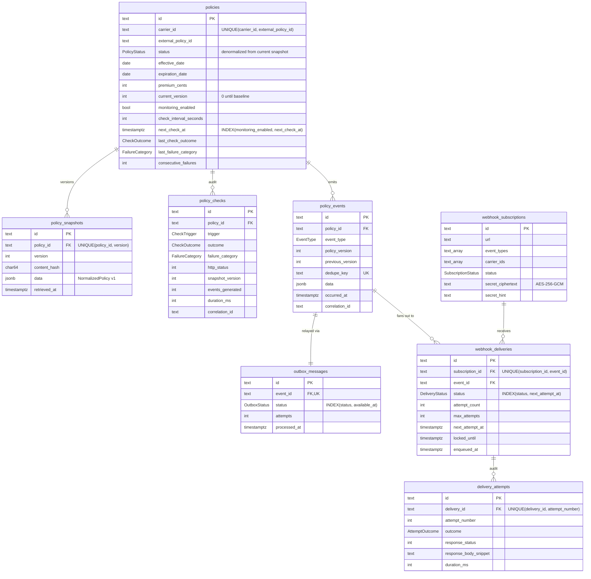

# Database schema

PostgreSQL 17, managed with Prisma Migrate (`prisma/schema.prisma`, `prisma/migrations/`). Tables and
columns are snake_case; every timestamp is `timestamptz(3)` so raw-SQL comparisons against `now()`
are correct regardless of the session time zone. Policy dates are `date` (calendar dates, not instants).

IDs are application-generated, prefixed and time-sortable (`pol_`, `snp_`, `chk_`, `evt_`, `obx_`,
`sub_`, `dlv_`, `att_` + 26 Crockford base-32 characters, ULID-style and monotonic within a process).
Ordering by primary key therefore equals creation order, which gives stable keyset pagination with
no separate sort column, and IDs reveal what they refer to in logs.

## Tables

### `policies` — what is monitored
One row per enrolled `(carrier_id, external_policy_id)`. The `status`/`effective_date`/
`expiration_date`/`premium_*` columns are a denormalized copy of the current snapshot so that list
and filter queries never unpack JSON. Monitoring state (`next_check_at`, `consecutive_failures`,
`last_failure_category`) lives here too. The policy row is the **lock** that serializes concurrent
checks (`SELECT … FOR UPDATE`).

### `policy_snapshots` — immutable history
Append-only. A new version is written only when the canonical content hash differs from the current
version's, so the table is a compact change history rather than a copy of every poll.
`UNIQUE(policy_id, version)` makes it impossible for two transactions to both create "version N+1".

### `policy_checks` — monitoring audit
Every attempt, successful or not, with trigger, outcome, failure category, carrier HTTP status,
duration and correlation ID. This is how "carrier unavailable for 3 hours" is distinguishable from
"nothing changed for 3 hours".

### `policy_events` — domain events
Immutable. `dedupe_key = <policyId>:v<version>:<eventType>:<discriminator>` (discriminator = VIN for
vehicle events) is `UNIQUE`, so a given change can never be recorded twice. `policy_version` /
`previous_version` link each event to the snapshots it compares.

### `outbox_messages` — transactional outbox
Written in the same transaction as the event (one-to-one). The relay selects
`status = 'PENDING' … FOR UPDATE SKIP LOCKED`, creates deliveries and marks the row `PROCESSED` in a
single transaction.

### `webhook_subscriptions`
Event-type and carrier filters as `text[]` (`'*'` = all event types; empty carriers = all). The signing
secret is stored only as AES-256-GCM ciphertext (`v1.<iv>.<tag>.<ciphertext>`) keyed by
`SECRET_ENCRYPTION_KEY`; `secret_hint` keeps the last four characters for identification. Deletion is
soft (`status = 'DELETED'`) so the delivery audit trail keeps its foreign keys.

### `webhook_deliveries` — one logical delivery per (subscription, event)
`UNIQUE(subscription_id, event_id)` is the fan-out idempotency guarantee. Columns implement the
delivery state machine (see [architecture.md](architecture.md#delivery-state-machine)):

| Column | Purpose |
|---|---|
| `status`, `next_attempt_at` | What should happen next and when (`INDEX(status, next_attempt_at)` serves the sweeper) |
| `attempt_count`, `max_attempts` | Bounded retries; manual redelivery raises `max_attempts` |
| `locked_until` | Lease held by the worker currently sending (claim is a single conditional `UPDATE … RETURNING`) |
| `enqueued_at` | Last time a queue job was created; lets the sweeper avoid re-enqueue storms |
| `last_response_status`, `last_error`, `succeeded_at`, `failed_at` | Inspection without joining attempts |

### `delivery_attempts` — HTTP audit trail
One row per request actually sent (or blocked), `UNIQUE(delivery_id, attempt_number)`. Stores the
destination host (not the full URL, which may contain tokens), outcome, status, the first 512 bytes
of the response, duration and the signature timestamp used.

## Transaction boundaries

| Operation | Transaction contents | Isolation technique |
|---|---|---|
| Successful check | lock policy row → read current snapshot → insert snapshot → insert events → insert outbox rows → update policy → insert check | Row lock + unique constraints; retried on unique violation |
| Failed check | insert check + update monitoring columns (batch transaction) | No policy-state columns touched |
| Scheduler tick | select due policies `FOR UPDATE SKIP LOCKED` → push `next_check_at` by the lease | Rows partitioned across schedulers |
| Outbox relay | select pending `FOR UPDATE SKIP LOCKED` → insert deliveries (`ON CONFLICT DO NOTHING`) → mark processed | Rows partitioned across relays |
| Delivery claim | one `UPDATE … WHERE claimable RETURNING` | Atomic compare-and-set |
| Delivery result | insert attempt + `UPDATE … WHERE status='IN_PROGRESS' AND attempt_count = n` | Stale workers cannot overwrite newer state |
| Manual redelivery | `SELECT … FOR UPDATE OF d` → validate state → reset | Serialized with claims |

Network I/O (carrier calls, webhook POSTs) never happens inside a transaction.

## Retention

Nothing is pruned automatically. For a long-running deployment, add scheduled deletion of
`policy_checks` and `delivery_attempts` older than the audit-retention period, and of
`outbox_messages` in `PROCESSED` state (they are redundant once deliveries exist).
