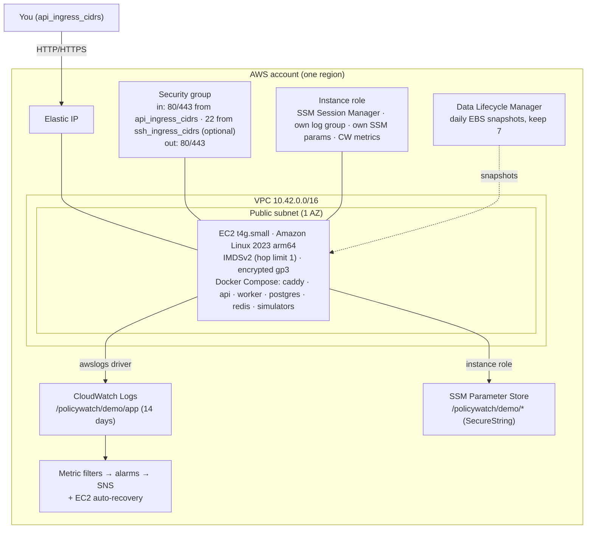

# AWS deployment (optional)

PolicyWatch runs entirely locally with Docker Compose. This guide deploys the same stack to a single,
cost-conscious EC2 host: **Terraform** provisions the infrastructure, **Ansible** configures the host
and deploys the containers.

> **Nothing here runs automatically.** No command in this repository creates AWS resources unless
> you run `terraform apply` yourself. Review the plan before applying.

> **Verification status.** The Terraform configuration passes `terraform validate` against the AWS
> provider (v6.70) and seven offline plan tests with a mocked provider (`terraform test`). The Ansible
> playbook passes `--syntax-check` and `ansible-lint` (production profile). Neither has been applied
> to a real AWS account or a real Amazon Linux 2023 host by the author of this repository, and the
> Docker images are built in CI rather than on the development machine. Treat the first deployment
> as a test and watch it.

## What gets created



PostgreSQL and Redis are containers on the Docker network: no published ports, no security-group
rule, not reachable from the internet or the VPC. Only Caddy (80/443) is exposed.

## Estimated cost

On-demand prices in `us-east-1`, checked against AWS public pricing at the time of writing — verify
current prices for your region before deploying.

| Item | Approx. monthly |
|---|---|
| EC2 t4g.small (730 h × $0.0168) | $12.26 |
| Public IPv4 address (730 h × $0.005) | $3.65 |
| EBS gp3 20 GiB | $1.60 |
| EBS snapshots (incremental, 7 kept) | ≤ $1.00 |
| CloudWatch: 9 custom metrics, 3 alarms, light log volume | ≈ $3–4 |
| **Total** | **≈ $20–23 / month (≈ $0.03 / hour)** |

Destroy the stack when you are done. Free-tier credits may reduce this, but do not rely on them.
`t4g` CPU credits are set to `standard` so a CPU-heavy period is throttled instead of billed.

## Prerequisites

- An AWS account and credentials via the standard chain (`aws configure sso` / `AWS_PROFILE`).
  Never put credentials in this repository or in `terraform.tfvars`.
- Terraform ≥ 1.6, AWS CLI v2, Ansible (ansible-core ≥ 2.15), `openssl`, an SSH key pair.

## 1. Provision infrastructure

```bash
cd infra/terraform
cp terraform.tfvars.example terraform.tfvars   # set api_ingress_cidrs, ssh_ingress_cidrs, ssh_public_key
terraform init
terraform plan -out tfplan                     # review every resource
terraform apply tfplan                          # creates billable resources
```

`api_ingress_cidrs` has no default on purpose; `ssh_ingress_cidrs` rejects `0.0.0.0/0`. Leave SSH
closed and use `aws ssm start-session --target <instance-id>` if you prefer (Ansible then needs an
SSM connection plugin, not covered here).

## 2. Store secrets (once per environment)

```bash
cd ../..
AWS_REGION=us-east-1 PROJECT=policywatch ENVIRONMENT=demo infra/scripts/put-secrets.sh
```

Creates SecureString parameters `/policywatch/demo/{ADMIN_API_KEY, READONLY_API_KEY,
SECRET_ENCRYPTION_KEY, POSTGRES_PASSWORD, REDIS_PASSWORD}` with freshly generated values. They are
never printed or written to disk. The instance role may read only this path.

## 3. Configure the host and deploy

```bash
cd infra/terraform
terraform output -raw ansible_inventory > ../ansible/inventory/hosts.yml
ssh-keyscan -H "$(terraform output -raw public_ip)" >> ~/.ssh/known_hosts
cd ../ansible
ansible-playbook playbooks/site.yml
```

The playbook:

1. **common** — security updates now and via `dnf-automatic`, chrony, SSH hardening (keys only, no
   root), a 1 GiB swap file, `vm.overcommit_memory=1` for Redis.
2. **docker** — Docker Engine from the AL2023 repository; the Compose v2 plugin from GitHub releases
   with checksum verification; daemon defaults: `awslogs` to the log group, `live-restore`,
   `no-new-privileges`.
3. **cloudwatch_agent** — memory, swap and disk metrics (`CWAgent` namespace).
4. **policywatch** — packages the repository locally, unpacks it into
   `/opt/policywatch/releases/<git-sha>`, reads secrets **on the host** from SSM with the instance role,
   renders `/opt/policywatch/.env` (root, `0600`, `no_log`), builds images, installs a systemd unit
   that starts the Compose stack at boot, applies changes with `docker compose up -d` (only changed
   containers restart; migrations run first as a one-shot service), waits until `/health` reports
   `ok` from inside the API container, and keeps the last three releases.

Re-run the playbook to deploy a new commit (`--tags app` skips host configuration).

## 4. Verify

```bash
API=$(cd ../terraform && terraform output -raw api_url)
curl -s "$API/health" | jq .
KEY=$(aws ssm get-parameter --with-decryption --name /policywatch/demo/ADMIN_API_KEY --query Parameter.Value --output text)
curl -s "$API/policies" -H "Authorization: Bearer $KEY" | jq '.data | length'
aws logs tail /policywatch/demo/app --follow
```

Run the demo on the host (it talks to the internal simulator and receiver):

```bash
aws ssm start-session --target "$(cd ../terraform && terraform output -raw instance_id)"
sudo docker compose -f /opt/policywatch/current/deploy/docker-compose.prod.yml \
  --env-file /opt/policywatch/.env --profile tools run --rm demo
```

### HTTPS

Point a DNS name at the Elastic IP, set `domain_name` in `terraform.tfvars` and re-apply (this
updates the inventory's `site_address`), regenerate the inventory, and re-run Ansible. Caddy obtains
and renews a Let's Encrypt certificate automatically. Without a domain the API is served over plain
HTTP on the IP — acceptable only for a short, IP-restricted demo with synthetic data.

### Before using real subscriber URLs

The deployed demo allowlists the internal `mock-receiver` host. Set
`policywatch_webhook_allowed_hosts: ""` in `infra/ansible/group_vars/all.yml` and re-deploy so the full
SSRF policy applies to every destination.

## 5. Tear down

```bash
cd infra/terraform
terraform destroy
```

Then remove what Terraform does not own:

```bash
# Snapshots created by Data Lifecycle Manager survive the policy's deletion
aws ec2 describe-snapshots --owner-ids self --filters Name=tag:Snapshot,Values=policywatch-demo-daily \
  --query 'Snapshots[].SnapshotId' --output text | xargs -n1 aws ec2 delete-snapshot --snapshot-id
# Application secrets
aws ssm delete-parameters --names /policywatch/demo/{ADMIN_API_KEY,READONLY_API_KEY,SECRET_ENCRYPTION_KEY,POSTGRES_PASSWORD,REDIS_PASSWORD}
```

Confirm in the console (EC2 → Instances, Elastic IPs, Snapshots) that nothing billable remains.

## Production hardening not included (deliberately)

Multi-AZ (RDS for PostgreSQL, ElastiCache for Redis, an ALB, ≥ 2 app hosts or ECS), point-in-time
recovery, WAF and rate limiting, VPC flow logs, a private subnet with VPC endpoints instead of a public
IP, images pulled from a registry (ECR) with signed digests instead of building on the host, and secret
rotation.
